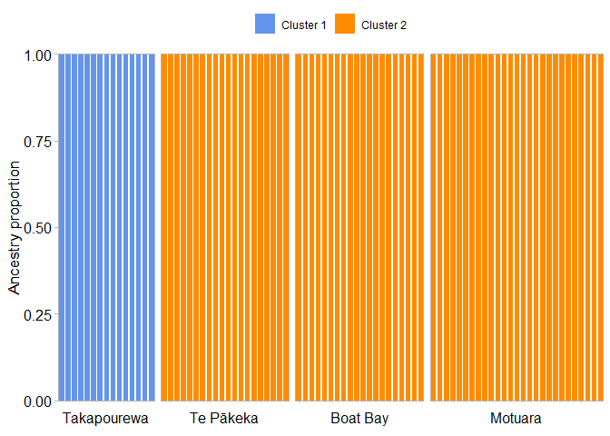

Admixture
================
Hadley Muller
2026-11-03

# ADMIXTURE: data visualisation in R

## Data Import and Setup

``` r
rm(list = ls())

library(ggplot2)
```

    ## Warning: package 'ggplot2' was built under R version 4.5.3

``` r
library(dplyr)
```

    ## Warning: package 'dplyr' was built under R version 4.5.3

    ## 
    ## Attaching package: 'dplyr'

    ## The following objects are masked from 'package:stats':
    ## 
    ##     filter, lag

    ## The following objects are masked from 'package:base':
    ## 
    ##     intersect, setdiff, setequal, union

``` r
library(tidyr)
```

    ## Warning: package 'tidyr' was built under R version 4.5.3

``` r
# Load data
Q <- read.table("filtered_renamed.2.Q")
fam <- read.table("filtered_renamed.fam")

Admixture <- data.frame(
  INDV = fam$V2,
  Cluster1 = Q$V1,
  Cluster2 = Q$V2
)

# Assign populations
Admixture <- Admixture %>%
  mutate(Pop = case_when(
    grepl("^B", INDV) ~ "Boat Bay",
    grepl("^T", INDV) ~ "Takapourewa",
    grepl("^M_", INDV) ~ "Te Pākeka",
    grepl("^MT", INDV) ~ "Motuara",
    grepl("^G", INDV) ~ "Te Pākeka"
  ))

Admixture$Pop <- factor(Admixture$Pop,
  levels = c("Takapourewa", "Te Pākeka", "Boat Bay", "Motuara"))

# Make Takapourewa blue
if (mean(Admixture$Cluster1[Admixture$Pop == "Takapourewa"]) <
    mean(Admixture$Cluster2[Admixture$Pop == "Takapourewa"])) {
  Admixture[c("Cluster1", "Cluster2")] <-
    Admixture[c("Cluster2", "Cluster1")]
}

# Order individuals and prepare for plotting
Admixture <- Admixture %>%
  arrange(Pop, desc(Cluster1)) %>%
  group_by(Pop) %>%
  mutate(Individual = row_number()) %>%
  ungroup() %>%
  pivot_longer(c(Cluster1, Cluster2),
               names_to = "Cluster", values_to = "Ancestry")
```

## Plotting

``` r
A <- ggplot(Admixture,
            aes(x = Individual, y = Ancestry, fill = Cluster)) +
  geom_col(width = 0.92, colour = "white", linewidth = 0.12) +
  facet_grid(~ Pop, scales = "free_x", space = "free_x",
             switch = "x") +
  scale_fill_manual(
  values = c("Cluster1" = "cornflowerblue",
             "Cluster2" = "darkorange"),
  labels = c("Cluster 1", "Cluster 2")
) +
  scale_x_continuous(expand = c(0, 0)) +
  scale_y_continuous(limits = c(0, 1), expand = c(0, 0)) +
  labs(x = NULL, y = "Ancestry proportion",
       fill = NULL) +
  theme_light() +
  theme(
    axis.title.y = element_text(size = 13, colour = "black"),
    axis.text.x = element_blank(),
    axis.ticks.x = element_blank(),
    axis.text.y = element_text(size = 12, colour = "black"),
    strip.background = element_blank(),
    strip.placement = "outside",
    strip.text.x = element_text(size = 12, colour = "black"),
    panel.spacing.x = grid::unit(0.2, "cm"),
    legend.position = "top"
  )

A
```

<!-- -->

``` r
ggsave(filename="Figure Supp_Admix.pdf", plot = A, dpi = 300, width = 11, height = 4, device = cairo_pdf)
```
