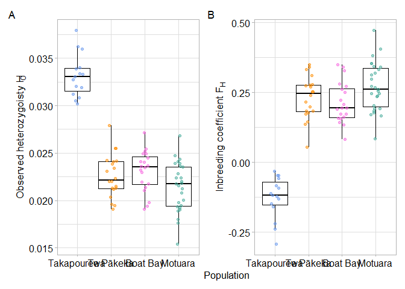

# Genetic Diversity and Inbreeding

I compared heterozygosity and, inbreeding across the four
populations sequenced.

## Data Import and Setup

``` r
# Clear workspace
rm(list = ls())

# Load required Packages
library(ggplot2)
```

    ## Warning: package 'ggplot2' was built under R version 4.5.3

``` r
library(dplyr)
```

    ## Warning: package 'dplyr' was built under R version 4.5.3

    ## 
    ## Attaching package: 'dplyr'

    ## The following objects are masked from 'package:stats':
    ## 
    ##     filter, lag

    ## The following objects are masked from 'package:base':
    ## 
    ##     intersect, setdiff, setequal, union

``` r
library(patchwork)
```

    ## Warning: package 'patchwork' was built under R version 4.5.3

``` r
library(FSA)
```

    ## Warning: package 'FSA' was built under R version 4.5.3

    ## ## FSA v0.10.1. See citation('FSA') if used in publication.
    ## ## Run fishR() for related website and fishR('IFAR') for related book.

``` r
# Load data
Het <- read.table("het_Under065.het", header = TRUE)

#Add sample information to the dataframe
Het <- Het %>%
  mutate(Pop = case_when(
    grepl("^B", INDV) ~ "Boat Bay",   
    grepl("^T", INDV) ~ "Takapourewa",    
    grepl("^M_", INDV) ~ "Te Pākeka",
    grepl("^MT", INDV) ~ "Motuara",   
    grepl("^G", INDV) ~ "Te Pākeka"
    ))

#Calculate the proportion of heterozygotes
Het$Prop.Het <- (Het$N_SITES - Het$O.HOM.) / Het$N_SITES

#Set factor levels, in line with other visualisations
Het$Pop <- factor(Het$Pop, levels = c("Takapourewa", "Te Pākeka", "Boat Bay", "Motuara" ))
```

## Simple Kruskal-Wallis

First for heterozygosity.

``` r
kruskal.test(Prop.Het ~ Pop, data = Het)
```

    ## 
    ##  Kruskal-Wallis rank sum test
    ## 
    ## data:  Prop.Het by Pop
    ## Kruskal-Wallis chi-squared = 31.724, df = 3, p-value = 5.982e-07

``` r
dunnTest(Prop.Het ~ Pop,
         data = Het,
         method = "bonferroni")
```

    ##   Kruskal-Wallis rank sum test
    ## 
    ## data: x and g
    ## Kruskal-Wallis chi-squared = 31.7244, df = 3, p-value = 0
    ## 
    ## 
    ##                       Dunn's Pairwise Comparison of x by g                      
    ##                                   (Bonferroni)                                  
    ## 
    ## Col Mean-│
    ## Row Mean │   Takapour   Te Pākek   Boat Bay
    ## ─────────┼─────────────────────────────────
    ## Te Pākek │   4.146966
    ##          │     0.0002*
    ##          │
    ## Boat Bay │   3.630644  -0.557691
    ##          │     0.0017*    1.0000 
    ##          │
    ##  Motuara │   5.544996   1.251438   1.849219
    ##          │     0.0000*    1.0000     0.3866 
    ## 
    ## FWER = 0.05
    ## Reject Ho if adjusted p ≤ FWER, where (unadjusted) p = Pr(|Z| ≥ |z|)
    ## Dunn (1964) Kruskal-Wallis multiple comparison
    ## 
    ##   p-values adjusted with the Bonferroni method.

    ##                Comparison          Z      P.unadj        P.adj
    ## 1 Takapourewa - Te Pākeka  4.1469664 3.369095e-05 2.021457e-04
    ## 2  Takapourewa - Boat Bay  3.6306445 2.827144e-04 1.696286e-03
    ## 3    Te Pākeka - Boat Bay -0.5576914 5.770551e-01 1.000000e+00
    ## 4   Takapourewa - Motuara  5.5449967 2.939596e-08 1.763758e-07
    ## 5     Te Pākeka - Motuara  1.2514386 2.107745e-01 1.000000e+00
    ## 6      Boat Bay - Motuara  1.8492193 6.442615e-02 3.865569e-01

And for inbreeding

``` r
kruskal.test(F ~ Pop, data = Het)
```

    ## 
    ##  Kruskal-Wallis rank sum test
    ## 
    ## data:  F by Pop
    ## Kruskal-Wallis chi-squared = 32.476, df = 3, p-value = 4.153e-07

``` r
dunnTest(F ~ Pop,
         data = Het,
         method = "bonferroni")
```

    ##   Kruskal-Wallis rank sum test
    ## 
    ## data: x and g
    ## Kruskal-Wallis chi-squared = 32.4764, df = 3, p-value = 0
    ## 
    ## 
    ##                       Dunn's Pairwise Comparison of x by g                      
    ##                                   (Bonferroni)                                  
    ## 
    ## Col Mean-│
    ## Row Mean │   Takapour   Te Pākek   Boat Bay
    ## ─────────┼─────────────────────────────────
    ## Te Pākek │  -4.267851
    ##          │     0.0001*
    ##          │
    ## Boat Bay │  -3.524101   0.803341
    ##          │     0.0025*    1.0000 
    ##          │
    ##  Motuara │  -5.586528  -1.156816  -2.017905
    ##          │     0.0000*    1.0000     0.2616 
    ## 
    ## FWER = 0.05
    ## Reject Ho if adjusted p ≤ FWER, where (unadjusted) p = Pr(|Z| ≥ |z|)
    ## Dunn (1964) Kruskal-Wallis multiple comparison
    ## 
    ##   p-values adjusted with the Bonferroni method.

    ##                Comparison          Z      P.unadj        P.adj
    ## 1 Takapourewa - Te Pākeka -4.2678513 1.973648e-05 1.184189e-04
    ## 2  Takapourewa - Boat Bay -3.5241019 4.249209e-04 2.549525e-03
    ## 3    Te Pākeka - Boat Bay  0.8033412 4.217776e-01 1.000000e+00
    ## 4   Takapourewa - Motuara -5.5865287 2.316533e-08 1.389920e-07
    ## 5     Te Pākeka - Motuara -1.1568164 2.473474e-01 1.000000e+00
    ## 6      Boat Bay - Motuara -2.0179052 4.360113e-02 2.616068e-01

## Descriptive Statistics

I want overall, and by populations

``` r
mean(Het$Prop.Het)
```

    ## [1] 0.02203212

``` r
mean(Het$F)
```

    ## [1] 0.2016422

``` r
sd(Het$Prop.Het)
```

    ## [1] 0.003056993

``` r
sd(Het$F)
```

    ## [1] 0.1107676

``` r
group_mean <- Het %>%
  group_by(Pop) %>%
  summarise_at(vars(Prop.Het, F),
               list(mean = mean))

print(group_mean)
```

    ## # A tibble: 4 × 3
    ##   Pop         Prop.Het_mean F_mean
    ##   <fct>               <dbl>  <dbl>
    ## 1 Takapourewa        0.0260 0.0598
    ## 2 Te Pākeka          0.0215 0.223 
    ## 3 Boat Bay           0.0219 0.202 
    ## 4 Motuara            0.0203 0.265

## Create Jitterplots

``` r
#Total Sites
A <- ggplot(Het, aes(x = Pop, y = Prop.Het, colour = Pop)) +
  geom_boxplot(outlier.shape = NA, colour = "black") +
  geom_jitter(width = 0.15, alpha = 0.5) +
  theme_light() +
  ylab(expression("Observed heterozygoisty H"  [O])) +
  xlab("Population") +
   scale_colour_manual(values = c("cornflowerblue", "darkorange","#F763E0", "#44AA99")) +
    theme(
    axis.title.x = element_text(size = 13, colour = "black", face = "plain"),
    axis.title.y = element_text(size = 13, colour = "black", face = "plain"),
    axis.text.x  = element_text(size = 12, colour = "black"),
    axis.text.y  = element_text(size = 12, colour = "black")
  ) +
  theme(legend.position="none")


#Inbreeding F(is)
B <- ggplot(Het, aes(x = Pop, y = F, colour = Pop)) +
  geom_boxplot(outlier.shape = NA, colour = "black") +
  geom_jitter(width = 0.15, alpha = 0.5) +
  theme_light() +
  ylab(expression("Inbreeding coefficient F" [H])) +
  xlab("Population") +
  scale_colour_manual(values = c("cornflowerblue", "darkorange","#F763E0", "#44AA99")) +
  theme(
    axis.title.x = element_text(size = 13, colour = "black", face = "plain"),
    axis.title.y = element_text(size = 13, colour = "black", face = "plain"),
    axis.text.x  = element_text(size = 12, colour = "black"),
    axis.text.y  = element_text(size = 12, colour = "black")
  ) +
  theme(legend.position="none")
```

``` r
Together <- (plots = wrap_plots(A,B)) +
  plot_layout(axis_titles = "collect") + plot_annotation(tag_levels = "A")

Together
```

<!-- -->

``` r
ggsave(filename="Figure 3.pdf", plot = Together, dpi = 300, width = 11, height = 7, device = cairo_pdf)
```
