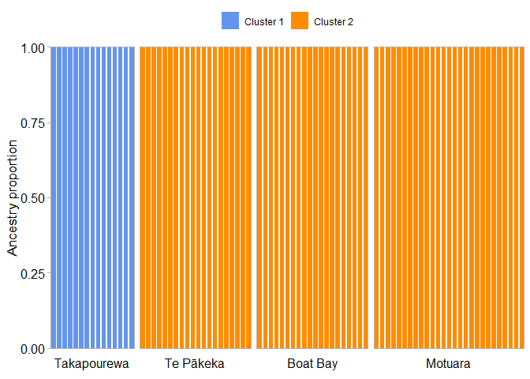

# Admixture Analysis
Based on the [tutorial](https://speciationgenomics.github.io/ADMIXTURE/) 
Run on the Otago University's HPC *Aoraki* for Supplementary Information based on reviewer suggestions.

```bash
## Already contains necessary packages to have re-run all other analyses with additional filtering:
source /projects/sciences/zoology/rawlence_lab/conda/etc/profile.d/conda.sh
export PYTHONNOUSERSITE=1
conda activate bcftools_hadley

conda install -c conda-forge -c bioconda admixture

mkdir admixture
cd admixture
```

## File conversion
```bash
#!/bin/bash
#SBATCH --job-name=Filter_plink
#SBATCH --cpus-per-task=1
#SBATCH --mem-per-cpu=4G
#SBATCH --time=02:00:00
#SBATCH --output=logs/Filter_plink_%j.log
#SBATCH --chdir=
##----------Set Up-------------##
set -euo pipefail
mkdir -p logs

source /projects/sciences/zoology/rawlence_lab/conda/etc/profile.d/conda.sh
export PYTHONNOUSERSITE=1
conda activate bcftools_hadley


##----------Code-------------##
awk '{if($0 !~ /^#/) print "contig"$0; else print $0}' ../HamFrogR08maxsnps1DP5.Under065.vcf > PLINKvcf_with_contig.vcf

echo "filtering singletons and invariant sites..."
vcftools --vcf PLINKvcf_with_contig.vcf \
	--mac 2 \
	--min-alleles 2 --max-alleles 2 \
	--recode --recode-INFO-all \
	--stdout | bgzip -c > filtered_renamed.vcf.gz

bcftools index -t filtered_renamed.vcf.gz

echo "converting to plink bed/bim/fam..."
plink --vcf filtered_renamed.vcf.gz --make-bed --out filtered_renamed --allow-extra-chr --double-id

echo "zeroing out chromosome codes in bim..."
awk '{$1="0";print $0}' filtered_renamed.bim > filtered_renamed.bim.tmp
mv filtered_renamed.bim.tmp filtered_renamed.bim

echo "done"
```

## Run 
Note: the run of admixture below is an array that will run jobs for each value of K between 2 and 12 (see line 57 '''#SBATCH --array=2-12''')
```
#!/bin/bash
#SBATCH --job-name=Frog_admixture
#SBATCH --array=2-12
#SBATCH --ntasks=1
#SBATCH --cpus-per-task=8
#SBATCH --mem-per-cpu=6G
#SBATCH --time=24:00:00
#SBATCH --output=logs/admixture_%a_%j.log
##----------Set Up-------------##
set -euo pipefail

source /projects/sciences/zoology/rawlence_lab/conda/etc/profile.d/conda.sh
export PYTHONNOUSERSITE=1
conda activate bcftools_hadley

FILE=filtered_renamed.bed

admixture --cv -j${SLURM_CPUS_PER_TASK} $FILE ${SLURM_ARRAY_TASK_ID} > log${SLURM_ARRAY_TASK_ID}.out
```

## Results
Grouping of two has the lowest CV error which aligns with an intuitive understanding of Hamilton's frog phylogeography:
```
log10.out:CV error (K=10): 0.38009
log11.out:CV error (K=11): 0.38260
log12.out:CV error (K=12): 0.41503
log2.out:CV error (K=2): 0.23532
log3.out:CV error (K=3): 0.27520
log4.out:CV error (K=4): 0.29071
log5.out:CV error (K=5): 0.30999
log6.out:CV error (K=6): 0.32591
log7.out:CV error (K=7): 0.33965
log8.out:CV error (K=8): 0.35469
log9.out:CV error (K=9): 0.36008
```

# Visualisation in R
## Data Import and Setup

``` r
rm(list = ls())

library(ggplot2)
```

    ## Warning: package 'ggplot2' was built under R version 4.5.3

``` r
library(dplyr)
```

    ## Warning: package 'dplyr' was built under R version 4.5.3

    ## 
    ## Attaching package: 'dplyr'

    ## The following objects are masked from 'package:stats':
    ## 
    ##     filter, lag

    ## The following objects are masked from 'package:base':
    ## 
    ##     intersect, setdiff, setequal, union

``` r
library(tidyr)
```

    ## Warning: package 'tidyr' was built under R version 4.5.3

``` r
# Load data
Q <- read.table("filtered_renamed.2.Q")
fam <- read.table("filtered_renamed.fam")

Admixture <- data.frame(
  INDV = fam$V2,
  Cluster1 = Q$V1,
  Cluster2 = Q$V2
)

# Assign populations
Admixture <- Admixture %>%
  mutate(Pop = case_when(
    grepl("^B", INDV) ~ "Boat Bay",
    grepl("^T", INDV) ~ "Takapourewa",
    grepl("^M_", INDV) ~ "Te Pākeka",
    grepl("^MT", INDV) ~ "Motuara",
    grepl("^G", INDV) ~ "Te Pākeka"
  ))

Admixture$Pop <- factor(Admixture$Pop,
  levels = c("Takapourewa", "Te Pākeka", "Boat Bay", "Motuara"))

# Make Takapourewa blue
if (mean(Admixture$Cluster1[Admixture$Pop == "Takapourewa"]) <
    mean(Admixture$Cluster2[Admixture$Pop == "Takapourewa"])) {
  Admixture[c("Cluster1", "Cluster2")] <-
    Admixture[c("Cluster2", "Cluster1")]
}

# Order individuals and prepare for plotting
Admixture <- Admixture %>%
  arrange(Pop, desc(Cluster1)) %>%
  group_by(Pop) %>%
  mutate(Individual = row_number()) %>%
  ungroup() %>%
  pivot_longer(c(Cluster1, Cluster2),
               names_to = "Cluster", values_to = "Ancestry")
```

## Plotting

``` r
A <- ggplot(Admixture,
            aes(x = Individual, y = Ancestry, fill = Cluster)) +
  geom_col(width = 0.92, colour = "white", linewidth = 0.12) +
  facet_grid(~ Pop, scales = "free_x", space = "free_x",
             switch = "x") +
  scale_fill_manual(
  values = c("Cluster1" = "cornflowerblue",
             "Cluster2" = "darkorange"),
  labels = c("Cluster 1", "Cluster 2")
) +
  scale_x_continuous(expand = c(0, 0)) +
  scale_y_continuous(limits = c(0, 1), expand = c(0, 0)) +
  labs(x = NULL, y = "Ancestry proportion",
       fill = NULL) +
  theme_light() +
  theme(
    axis.title.y = element_text(size = 13, colour = "black"),
    axis.text.x = element_blank(),
    axis.ticks.x = element_blank(),
    axis.text.y = element_text(size = 12, colour = "black"),
    strip.background = element_blank(),
    strip.placement = "outside",
    strip.text.x = element_text(size = 12, colour = "black"),
    panel.spacing.x = grid::unit(0.2, "cm"),
    legend.position = "top"
  )

A
```

<!-- -->

``` r
ggsave(filename="Figure Supp_Admix.pdf", plot = A, dpi = 300, width = 11, height = 4, device = cairo_pdf)
```
