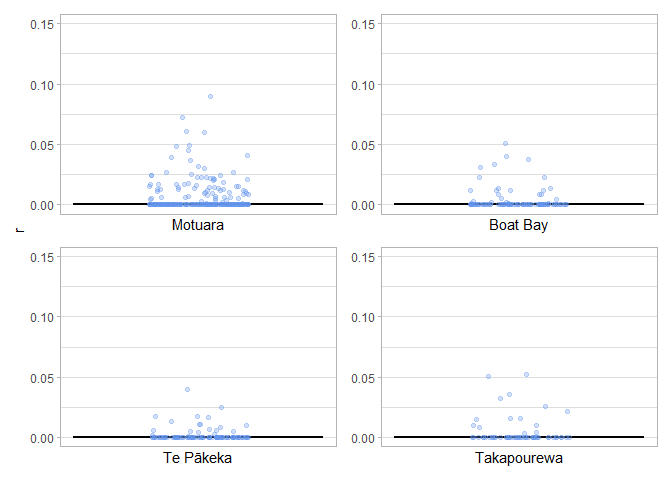

TrioML Plotting
================
Hadley Muller
2025-08-03

# Relatedness Plotting

I saved the .rds results locally from the HPC cluster to visualise
results.

## Data Import and Setup

``` r
# Clear workspace
rm(list = ls())

#Load required packages
library(ggplot2)
```

    ## Warning: package 'ggplot2' was built under R version 4.5.3

``` r
library(patchwork)
```

    ## Warning: package 'patchwork' was built under R version 4.5.3

``` r
library(dplyr)
```

    ## Warning: package 'dplyr' was built under R version 4.5.3

    ## 
    ## Attaching package: 'dplyr'

    ## The following objects are masked from 'package:stats':
    ## 
    ##     filter, lag

    ## The following objects are masked from 'package:base':
    ## 
    ##     intersect, setdiff, setequal, union

``` r
library(FSA)
```

    ## Warning: package 'FSA' was built under R version 4.5.3

    ## ## FSA v0.10.1. See citation('FSA') if used in publication.
    ## ## Run fishR() for related website and fishR('IFAR') for related book.

``` r
# Load data
Takapourewa <- readRDS("Takapourewa_results.rds")
TePakeka <- readRDS("TePakeka_results.rds")
Motuara <- readRDS("Motuara_results.rds")
Boatbay <- readRDS("BoatBay_results.rds")
```

## Simple ANOVA

### Create a merged data frame

``` r
data_list <- list(Boatbay, Takapourewa, Motuara, TePakeka)

# we must assign names, otherwise R will just index by position ....
names(data_list) <- c("BB", "TK", "MT", "TP")

for (i in 1:length(data_list)) {
  df <- data_list[[i]]
  
  df <- df$relatedness %>% select(group, trioml)
  
  data_list[[i]] <- df
  assign(names(data_list)[i], df)
}

# merge into a dataframe, we use do.call() 
    # similar to sapply() but it outputs the result of the called function with       all arguments not a list etc. of the results per element.

TrioML <- do.call(rbind, data_list)
```

### Kruskal and meanss

``` r
kruskal.test(trioml ~ group, data = TrioML)
```

    ## 
    ##  Kruskal-Wallis rank sum test
    ## 
    ## data:  trioml by group
    ## Kruskal-Wallis chi-squared = 16.174, df = 3, p-value = 0.001044

``` r
dunnTest(trioml ~ group,
         data = TrioML,
         method = "bonferroni")
```

    ## Warning: group was coerced to a factor.

    ##   Kruskal-Wallis rank sum test
    ## 
    ## data: x and g
    ## Kruskal-Wallis chi-squared = 16.1744, df = 3, p-value = 0
    ## 
    ## 
    ##                       Dunn's Pairwise Comparison of x by g                      
    ##                                   (Bonferroni)                                  
    ## 
    ## Col Mean-│
    ## Row Mean │       BBBB       MAMA       MTMT
    ## ─────────┼─────────────────────────────────
    ##     MAMA │   0.853370
    ##          │     1.0000 
    ##          │
    ##     MTMT │  -2.721145  -3.693236
    ##          │     0.0390*    0.0013*
    ##          │
    ##     TATA │  -0.377073  -1.097078   1.791140
    ##          │     1.0000     1.0000     0.4396 
    ## 
    ## FWER = 0.05
    ## Reject Ho if adjusted p ≤ FWER, where (unadjusted) p = Pr(|Z| ≥ |z|)
    ## Dunn (1964) Kruskal-Wallis multiple comparison
    ## 
    ##   p-values adjusted with the Bonferroni method.

    ##    Comparison          Z      P.unadj       P.adj
    ## 1 BBBB - MAMA  0.8533700 0.3934541384 1.000000000
    ## 2 BBBB - MTMT -2.7211450 0.0065056216 0.039033729
    ## 3 MAMA - MTMT -3.6932369 0.0002214176 0.001328506
    ## 4 BBBB - TATA -0.3770726 0.7061196192 1.000000000
    ## 5 MAMA - TATA -1.0970785 0.2726070810 1.000000000
    ## 6 MTMT - TATA  1.7911402 0.0732707988 0.439624793

``` r
# means
group_mean <- TrioML %>%
    group_by(group) %>%
    summarise_at(vars(trioml),
                 list(Mean_relatedness = mean))


print(group_mean)
```

    ## # A tibble: 4 × 2
    ##   group Mean_relatedness
    ##   <chr>            <dbl>
    ## 1 BBBB           0.00190
    ## 2 MAMA           0.00109
    ## 3 MTMT           0.00406
    ## 4 TATA           0.00287

## Create Jitterplots

``` r
make_relatedness_plot <- function(data, pop_name) {
  ggplot(data$relatedness, aes(x = 1, y = trioml)) +
    geom_boxplot(outlier.shape = NA, fill = "grey90", colour = "black") +
    geom_jitter(width = 0.15, colour = "cornflowerblue", alpha = 0.3) +
    theme_light() +
    ylab(expression("r")) +
    xlab(pop_name) +
    scale_x_continuous(breaks = NULL) +
    scale_y_continuous(limits = c(0, 0.15), breaks = seq(0, 0.15, 0.05))
}
```

``` r
Mot   <- make_relatedness_plot(Motuara,   "Motuara")
Boat  <- make_relatedness_plot(Boatbay,   "Boat Bay")
TePa  <- make_relatedness_plot(TePakeka,  "Te Pākeka")
Taka  <- make_relatedness_plot(Takapourewa, "Takapourewa")

done <- (plots <- wrap_plots(Mot, Boat, TePa, Taka) +
  plot_layout(axis_titles = "collect"))

done
```

    ## Warning: Removed 124 rows containing missing values or values outside the scale range
    ## (`geom_point()`).

    ## Warning: Removed 85 rows containing missing values or values outside the scale range
    ## (`geom_point()`).

    ## Warning: Removed 84 rows containing missing values or values outside the scale range
    ## (`geom_point()`).

    ## Warning: Removed 45 rows containing missing values or values outside the scale range
    ## (`geom_point()`).

<!-- -->

``` r
ggsave(filename="done.png", plot = done, dpi = 300, width = 9, height = 8 )
```

    ## Warning: Removed 135 rows containing missing values or values outside the scale range
    ## (`geom_point()`).

    ## Warning: Removed 80 rows containing missing values or values outside the scale range
    ## (`geom_point()`).
    ## Removed 80 rows containing missing values or values outside the scale range
    ## (`geom_point()`).

    ## Warning: Removed 42 rows containing missing values or values outside the scale range
    ## (`geom_point()`).
